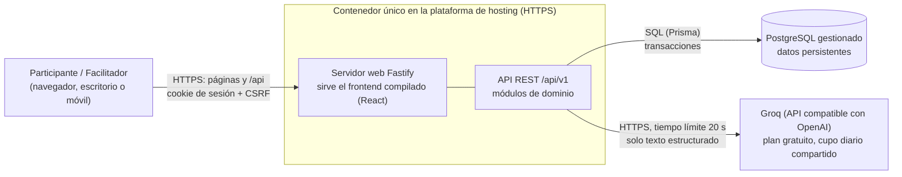

# Arquitectura general

Vista de alto nivel: un navegador, un servicio (API + estáticos), una base de datos y un proveedor de
IA externo (Groq). Decisiones en [research.md](../research.md) (D-02, D-09, D-15).

**Lectura**: el navegador solo habla con un origen. La IA nunca se invoca desde el navegador (la clave
vive solo en el servidor) y nunca escribe en la base de datos: sus respuestas se validan, se guardan
como interacción y se muestran como recomendaciones.
