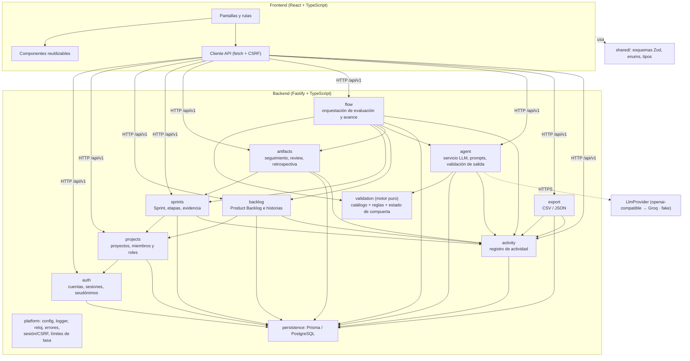

# Componentes del backend y dependencias entre módulos

Regla de dependencia: **rutas → servicios → dominio/repositorios**. El motor de validación es puro (sin
BD ni LLM). El agente consume resultados de reglas pero no puede cambiarlos. Detalle en
[plan.md](../plan.md#arquitectura-modular).

| Módulo | Responsabilidad | Expone a otros módulos |
|--------|-----------------|------------------------|
| `auth` | Registro, login, logout, sesión, CSRF, seudónimo | `requireAuth`, `currentUser` |
| `projects` | Proyectos, miembros, roles por proyecto, estado derivado | `requireProjectRole(roles)` |
| `backlog` | Elementos e historias, orden, versión | `getItemSnapshot` |
| `sprints` | Sprint, selección de elementos, etapas, evidencia | `getSprintSnapshot`, transiciones de etapa |
| `artifacts` | Seguimiento, Review, Retrospectiva y acciones | `getReviewSnapshot`, `getRetroSnapshot` |
| `validation` | Catálogo de criterios, `evaluate(snapshot) → resultados`, estado de compuerta | Funciones puras |
| `flow` | Evaluar compuerta (transacción), conceder excepción, completar etapa | `evaluateGate`, `grantException`, `completeStage` |
| `agent` | Contexto, prompts, llamada al LLM, validación de salida, presupuesto | `chat`, `feedbackForRun` |
| `activity` | Registro de solo inserción | `record(event)` |
| `export` | CSV/JSON sin datos personales | `generate(projectId, options)` |
