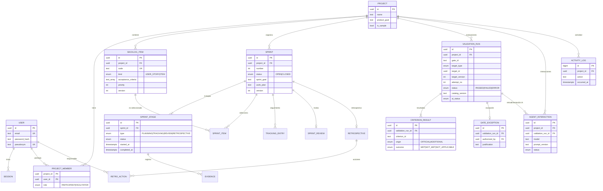

# Diagrama entidad-relación

Detalle de campos y restricciones en [data-model.md](../data-model.md). Se muestran solo las
columnas clave para mantener el diagrama legible.

`VALIDATION_RUN.target_id` apunta a `BACKLOG_ITEM`, `SPRINT`, `SPRINT_REVIEW` o `RETROSPECTIVE`
según `target_type` (sin clave foránea, validado por el servicio).
