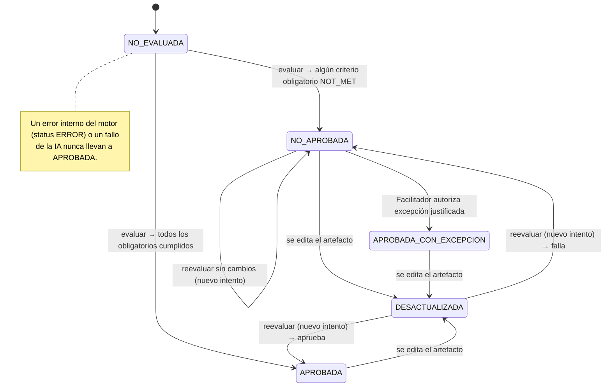
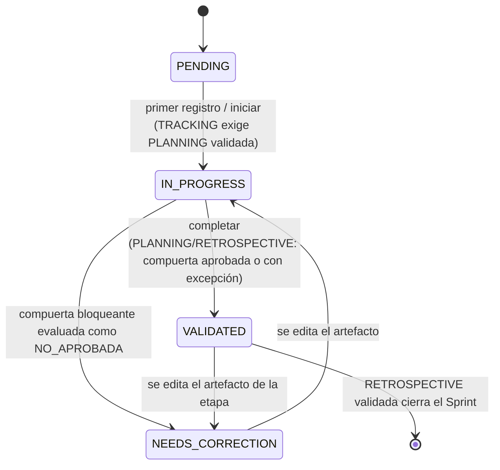

# Estados de las compuertas y de las etapas

Estados y transiciones definidos en [data-model.md](../data-model.md). El estado de compuerta se
**deriva** de la última evaluación y de la versión actual del objetivo; no depende de la IA.

## Compuerta (por objetivo y versión)

## Etapa del Sprint

Nota: solo `GATE-PLAN` y `GATE-RETRO` bloquean transiciones; `TRACKING` y `REVIEW` se cierran por
decisión del equipo, de modo que no se supone que Scrum obligue a secuenciar todos sus eventos
(ver [rules-catalog.md](../rules-catalog.md)).
