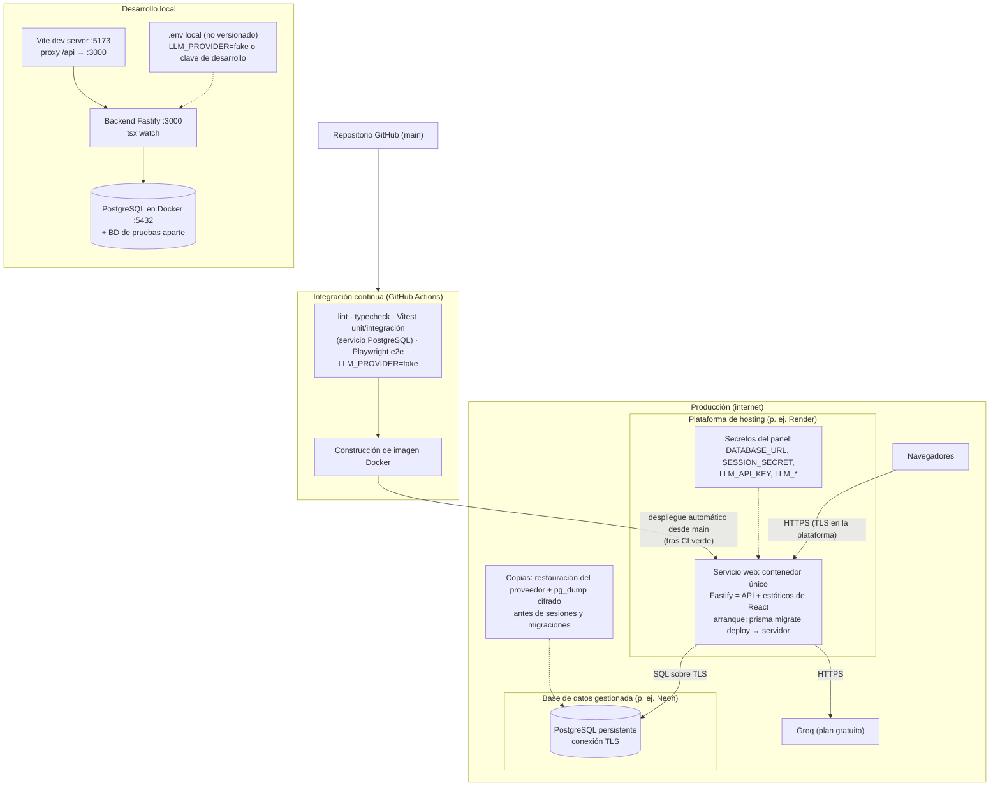

# Despliegue

Entornos separados: desarrollo local (Docker Compose solo para PostgreSQL; Vite con proxy) y
producción (contenedor único + PostgreSQL gestionado). Decisión de hosting y alternativas en
[research.md](../research.md) D-15; los precios y límites están **por verificar** antes de contratar.

Notas:

- CORS cerrado por defecto (mismo origen); `CORS_ALLOWED_ORIGINS` solo si se separa el frontend.
- `NODE_ENV=production` activa cookies `Secure`, `helmet` y logs JSON sin datos personales.
- Los datos de demostración y las cuentas de ejemplo solo se siembran en desarrollo.
